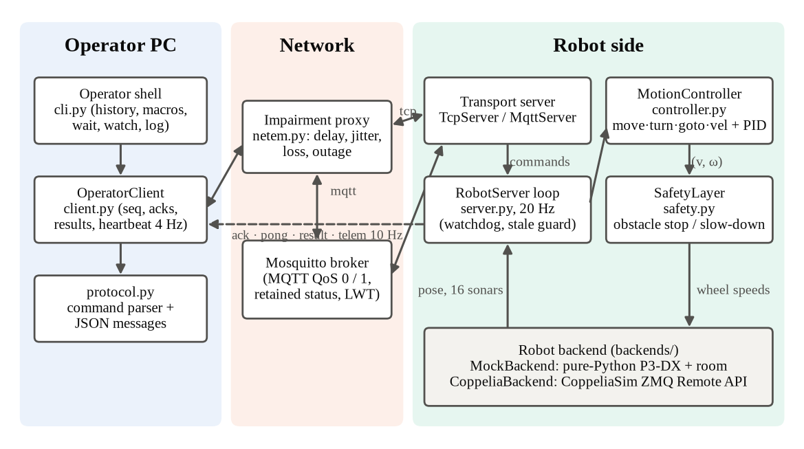

# Networked Teleoperation of a Robot through Shell Commands

**CSAI4014 – Algorithms for Intelligent Systems and Robotics** · UPES · B.Tech CSE (AI & ML), Semester VII
Batch B3 · Group G02 · Project P11

Control a remote mobile robot by typing shell commands. The commands are sent over **TCP sockets** or
**MQTT** to a simulated **Pioneer P3-DX** robot in **CoppeliaSim**. The robot executes them in closed loop
with PID control and protects itself with a **heartbeat watchdog** and an **emergency stop**. The project
also measures how network delay, jitter, packet loss and link outages affect closed-loop control.



---

## Features

- **Shell command interface**: `move`, `turn`, `goto`, `vel`, `stop`, `status`, `ping`, `reset`, plus
  history, macros, live telemetry and round-trip measurement.
- **Two transports**: plain TCP sockets, or MQTT (QoS 0 / QoS 1) through a Mosquitto broker.
- **Closed-loop control on the robot**: differential-drive kinematics, heading PID, and the move / turn /
  go-to-goal motion primitives.
- **Safety layer on the robot** that works even when the network fails:
  - obstacle slow-down and stop from the 16 sonars
  - link watchdog with a heartbeat: the robot stops within 1 s if the operator goes silent
  - stale-command guard: late motion commands are rejected
  - emergency stop (`stop` or Ctrl+C in the shell), and MQTT Last Will
- **Two simulators** behind one interface: CoppeliaSim (ZMQ Remote API) and a lightweight pure-Python
  P3-DX simulator for testing.
- **Network impairment emulator**: adds delay, jitter, loss and outages to any link.
- **Automated tests** and a reproducible experiment pipeline that produces the tables and plots.

## Requirements

- Python 3.10 or newer
- CoppeliaSim Edu 4.6+ (tested with 4.10), for the CoppeliaSim demo
- Mosquitto 2.x, for the MQTT transport

```bash
pip install -r requirements.txt
```

## Quick start

**Robot** (terminal 1)
```bash
python -m teleop.server --backend mock --transport tcp --port 9000
```
To use CoppeliaSim, open `scenes/teleop_p3dx.ttt` in CoppeliaSim first and use `--backend coppelia`.

**Operator** (terminal 2)
```bash
python -m teleop.cli --transport tcp --host 127.0.0.1 --port 9000
```
```
teleop> move 1
  <- ack #1 move ok (40.1 ms)
teleop> wait
  <- result #1 move: reached after 4.45 s, final error 0.025 m
teleop> turn 90
teleop> goto 1 1
teleop> status
  pose x=+0.999 m  y=+0.974 m  th= +88.64 deg | v=+0.00 m/s w=+0.00 rad/s | IDLE      mode=idle  obstacle=1.00 m
```

**Over MQTT** (with Mosquitto running: `mosquitto -c config/mosquitto.conf`)
```bash
python -m teleop.server --backend mock --transport mqtt --qos 1
python -m teleop.cli --transport mqtt --qos 1
```

**Through a bad network** (100 ms delay, 25 ms jitter, 1 % loss)
```bash
python -m teleop.netem --listen 9001 --target 127.0.0.1:9000 --delay 100 --jitter 25 --loss 0.01
python -m teleop.cli --transport tcp --port 9001
```

The full guide for Windows, Linux and macOS is in [docs/HOW_TO_RUN.md](docs/HOW_TO_RUN.md).

## Commands

| Command | Description |
|---|---|
| `move <dist> [speed]` | drive straight `dist` m (negative = backwards) |
| `turn <deg> [rate]` | rotate in place (positive = left) |
| `goto <x> <y> [speed]` | drive to a point in the world frame |
| `vel <v> <w>` | direct velocity control (m/s, deg/s) |
| `stop` | emergency stop |
| `status` · `ping` · `reset` | show telemetry · measure round trip · reset the simulation |
| `wait` `watch` `rtt` `macro` `log` `history` `help` `quit` | shell helpers |

## Results

The experiments cover TCP, MQTT QoS 0 and MQTT QoS 1 under four network conditions (none, 50 ms, 100 ms + 1 %
loss, 200 ms + 5 % loss), with 10 trials per setting. Key scenarios were repeated in CoppeliaSim.

| Finding | Result |
|---|---|
| Supervisory control (`goto`) on the worst link | all goals reached, same ~2.7 cm accuracy, only 10–18 % slower |
| Direct steering (`vel`) on the worst link | tracking error grows about 5×, most runs fail to finish |
| Obstacle safety, without any operator `stop` | robot stops at the 30 cm line, 0 collisions |
| Link outage | watchdog stops the robot about 1 s after the link fails, for every transport |
| MQTT QoS 1 after an outage | replays old commands; the stale guard rejects them |
| MQTT latency fix | QoS 1 round trip 55 ms → 1.2 ms with Nagle's algorithm disabled on client and broker |
| Collisions across all runs | **0** |

Full tables and discussion: [docs/RESULTS.md](docs/RESULTS.md) · figures in [results/figures/](results/figures/).

## Tests

```bash
python -m pytest
```
MQTT tests run when a broker is available on `127.0.0.1:1883` and are skipped otherwise.

## Project structure

```
teleop/          Python package: protocol, shell, transports, robot server,
                 controller, safety layer, simulators, network emulator
scenes/          CoppeliaSim scene (teleop_p3dx.ttt) and its build script
experiments/     experiment scenarios, runner and analysis
results/         raw data, tables and figures
tests/           automated tests
macros/          example command scripts for the shell
config/          Mosquitto configuration
docs/            how to run, architecture, protocol, setup, troubleshooting, results
report/          project report (Word and PDF)
```

## Documentation

- [How to run](docs/HOW_TO_RUN.md)
- [Architecture](docs/ARCHITECTURE.md)
- [Protocol](docs/PROTOCOL.md)
- [CoppeliaSim scene setup](docs/SCENE_SETUP.md)
- [MQTT / Mosquitto setup](docs/MQTT_SETUP.md)
- [Troubleshooting](docs/TROUBLESHOOTING.md)

## Team

Aniket Singh Bisht · Harsh Varma · Priyam Paliwal · Akshat Kumar Angi · Yeshang Soni
