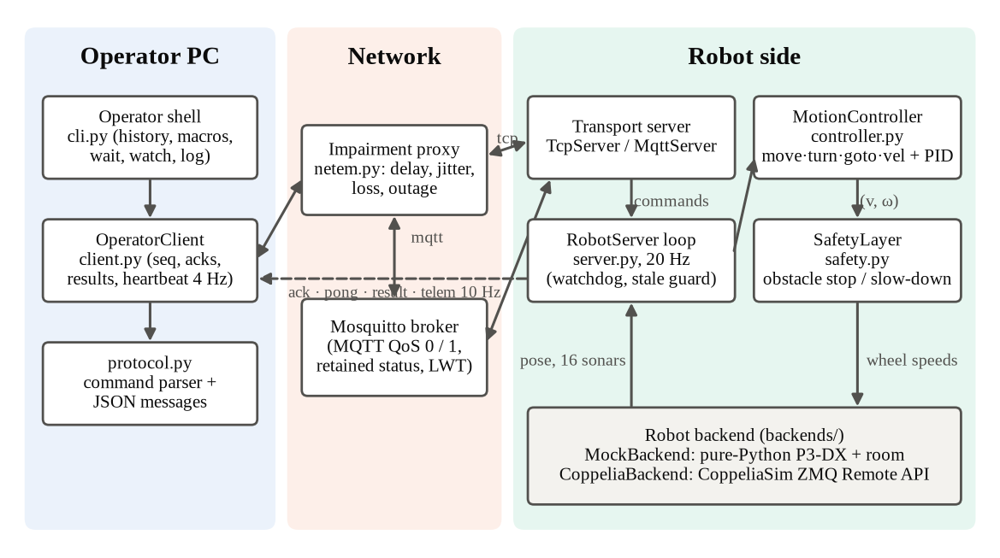
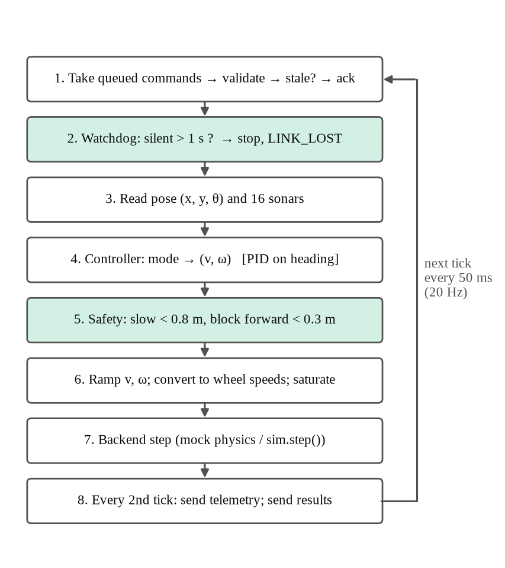
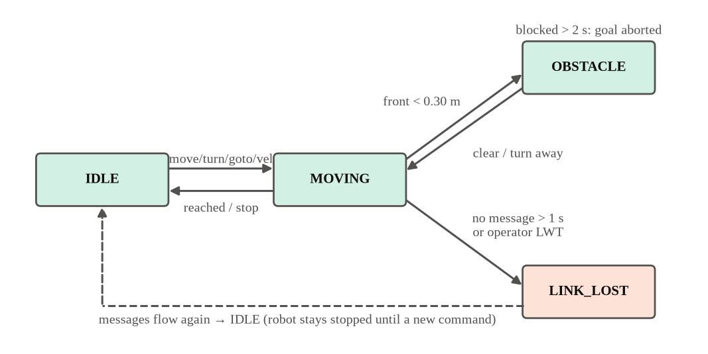
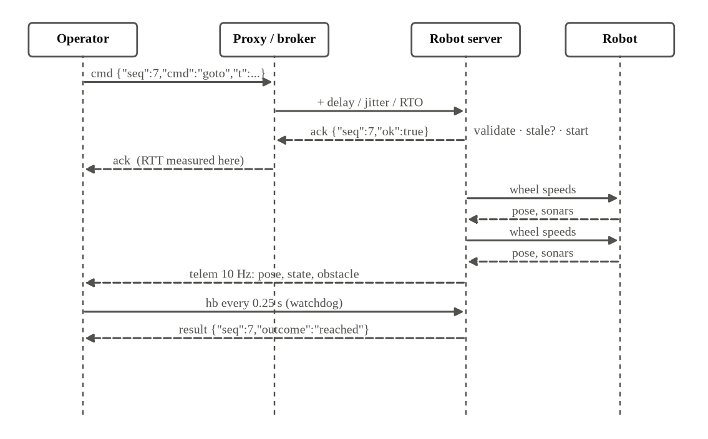

# Architecture

Diagram owner: **Aniket Singh Bisht**. Module owners are listed per box.

## Layers

| Layer | File(s) | Responsibility |
|---|---|---|
| Operator UI | `teleop/cli.py` | Reads typed lines, runs local helpers (wait, watch, macro, log, rtt), prints acks and results as they arrive |
| Operator API | `teleop/client.py` | Gives every command a `seq`, matches `ack`/`pong`/`result` to it, keeps the latest telemetry, sends a heartbeat every 0.25 s |
| Protocol | `teleop/protocol.py` | Text command grammar, JSON message format, TCP line framing, validation shared by both sides |
| Transport | `teleop/transport/tcp.py`, `mqtt.py` | Moves JSON messages. TCP: direct socket, exclusive control lock, auto-reconnect. MQTT: topics, QoS 0/1, persistent session, retained status, Last Will |
| Network emulation | `teleop/netem.py` | TCP proxy that adds delay, jitter, loss (as retransmission delay) and outages |
| Robot loop | `teleop/server.py` | 20 Hz loop: commands → watchdog → sense → control → safety → actuate → telemetry |
| Control | `teleop/controller.py`, `pid.py`, `kinematics.py` | Motion primitives move/turn/goto/vel; heading PID; differential-drive maths |
| Safety | `teleop/safety.py` | Obstacle slow-down/stop from sonars, link watchdog, stale-command guard |
| Robot backend | `teleop/backends/mock.py`, `coppelia.py` | Same interface, two implementations: pure-Python simulator, or CoppeliaSim via the ZMQ Remote API |

## Threads

* **Robot process:** one control-loop thread (fixed 20 Hz) and the transport's network thread(s). The
  network thread only puts messages in a `queue.Queue`. The control thread is the only one that touches
  the controller and the backend, so no locks are needed there. `ping` is answered from the network
  thread, so ping RTT measures the network only.
* **Operator process:** the main thread (shell), the transport's reader thread (fills in acks, results
  and telemetry, and prints results) and a heartbeat thread.

## Why the design looks like this

* **Safety lives on the robot.** The operator can be slow or gone, so the obstacle stop, the watchdog
  and the stale guard never wait for the network (see the results: zero collisions under every condition).
* **Supervisory commands (`goto`, `move`, `turn`) are closed on the robot.** Only the goal crosses the
  network, so delay changes the start time, not the accuracy. `vel` is direct control and suffers
  from delay (operator experiment S3).
* **One interface per concern.** `RobotBackend` and `ServerTransport`/`ClientTransport` are small
  abstract classes. Swapping mock for CoppeliaSim, or TCP for MQTT, is a command-line flag.
* **Everything tunable is in `config.py`**, so experiments change numbers, not code.

## Control loop

## Robot states

## Message sequence

